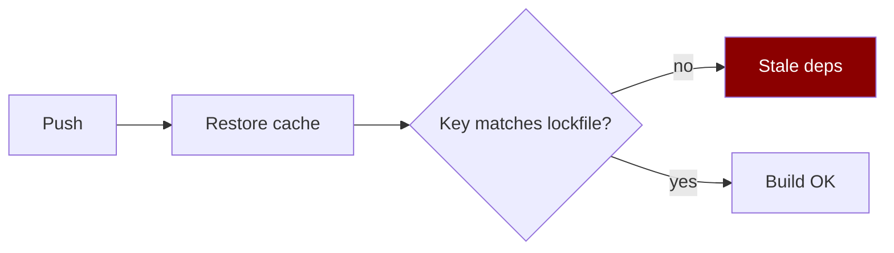
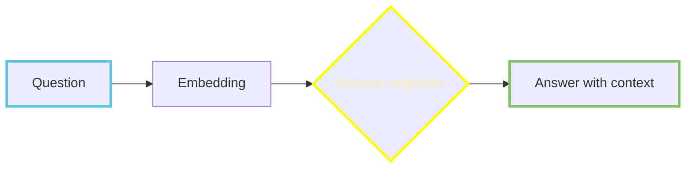

# Rung 2 — Diagram or chart

## Mermaid (flow, architecture, dependency map, timeline, decision tree; 4-12 nodes)

- Labels under 4 words. Mark the one node that matters with a class. Title states the takeaway: "Cache key skips lockfile", not "Deploy pipeline".
- Write Mermaid in a fenced block. If the client cannot show Mermaid (most chat apps), render to PNG and send the image.
- Keep the rung 1 summary above the diagram.

```bash
scripts/render.sh mmd flow.mmd flow.png   # ~5 s, system Chrome + mermaid-cli
```



## Chart (one data series whose shape is the answer)

- One chart only. Easiest: `scripts/report.py` with one `charts` entry, then `render.sh shot` to PNG.
- Title states the takeaway. Label units. No label may cover a bar or another label.
- Keep the deciding numbers in the text. The chart is support, not the answer.

## 3Blue1Brown style (concepts and mechanisms)

Use it when the diagram explains **how something works** or **why**: a mechanism, a concept, an intuition, a math or model idea. Do not use it for operational status, task lists or KPI reports; those keep the normal style.

- Render: `scripts/render.sh mmd3b in.mmd out.png` (background #1c1c1c, cream text, blue #58c4dd borders).
- One idea per diagram. Few nodes (4–8), a lot of space, short labels.
- Color carries meaning, never decoration: blue #58c4dd = the main thing, yellow #ffff00 / #fff1b6 = what changes or matters, green #83c167 = good result, red #fc6255 = error.
- Build the intuition in order: initial state → transformation → result. The title states the idea, not the topic.
- If the idea needs motion (a curve that changes, a step by step) and the user asks for a video, use Manim (`references/video.md`).


